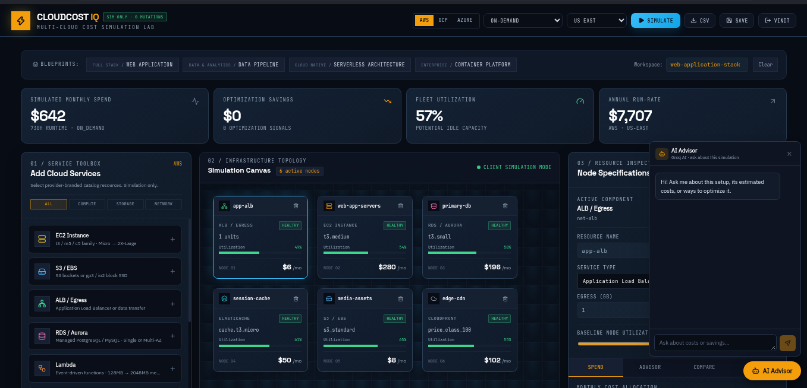
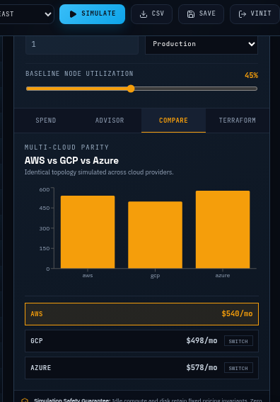
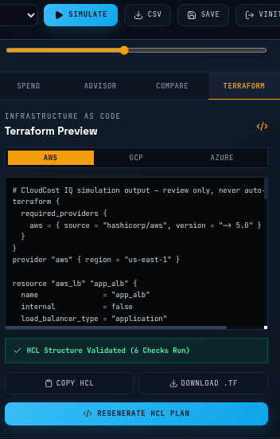

# ☁️ CloudCostIQ

### Multi-Cloud Cost Intelligence & GitOps Platform

Estimate, compare, and optimize cloud infrastructure costs before deployment.

CloudCostIQ lets you simulate workloads across AWS, Google Cloud, and Azure, explore cost-saving opportunities, and generate Terraform configuration previews — all from one dashboard.

**No cloud credentials. No actual cloud provisioning. Just smarter infrastructure planning.**

<p align="center">


</p>

---

## 📸 Screenshots

<p align="center">
  
  <br>
  <em>CloudCostIQ Dashboard</em>
</p>

<p align="center">
  
  <br>
  <em>Multi-Cloud Cost Comparison</em>
</p>

<p align="center">
  
  <br>
  <em>Terraform Configuration Preview</em>
</p>

---

## ✨ Features

- **Multi-Cloud Cost Simulation** — Estimate infrastructure costs across AWS, Google Cloud, and Azure.
- **Cost Comparison** — Compare providers, regions, and pricing models side by side.
- **AI-Powered Recommendations** — Generate cost optimization suggestions using Gemini, with a local rules-engine fallback.
- **AI Chatbot** — Conversational infrastructure assistance powered by Groq.
- **Terraform Preview** — Generate and validate Terraform configuration previews before using them in real infrastructure.
- **Workspace Management** — Save and reload workload configurations.
- **Containerized Deployment** — Run the complete application using Docker Compose.
- **GitOps Deployment** — Manage Kubernetes deployments through Argo CD with automated synchronization and self-healing.

---

## 🏗️ Architecture

```text
             Developer
                 |
                 v
             GitHub
                 |
          GitHub Actions
                 |
          Build & Validate
                 |
                 v
          Docker Images
                 |
                 v
          Kubernetes Cluster
                 |
              Argo CD
                 |
          GitOps Synchronization
                 |
       +---------+----------+
       |                    |
       v                    v
    Frontend              Backend
    Next.js               FastAPI
       |                    |
       +---------+----------+
                 |
                 v
              MongoDB
```

### Technology Stack

| Layer | Technology |
|---|---|
| Frontend | Next.js, React |
| Backend | Python, FastAPI |
| Database | MongoDB |
| Containerization | Docker, Docker Compose |
| CI/CD | GitHub Actions |
| GitOps / CD | Argo CD |
| Orchestration | Kubernetes |
| Infrastructure Preview | Terraform |
| AI Recommendations | Google Gemini |
| AI Chatbot | Groq |

---

## 🌿 Git Branching Strategy

CloudCostIQ uses separate Git branches to organize application development and DevOps implementation.

| Branch | Purpose |
|---|---|
| `main` | Main application code and stable project version |
| `dev` | DevOps implementation, Kubernetes manifests, Argo CD GitOps configuration, and deployment workflow |

### Development Workflow

```text
             main
               |
        Application Code
               |
               v
              dev
               |
       DevOps & GitOps
        Implementation
               |
       +-------+-------+
       |               |
   GitHub Actions   Kubernetes
      Workflow       Manifests
       |               |
       +-------+-------+
               |
             Argo CD
               |
               v
       Kubernetes Cluster
```

The `dev` branch is configured as the source for Argo CD synchronization, allowing changes to Kubernetes manifests to be detected and deployed automatically.

---

## 🚀 Run with Docker

### Prerequisites

- Docker
- Docker Compose v2

Clone the repository:

```bash
git clone https://github.com/Vinit-D-Bisht/CloudCostIQ.git
cd CloudCostIQ
```

Start the application:

```bash
./run.sh
```

Open the application:

**http://localhost:3000**

On the first run, the script creates `backend/.env` from the example settings and starts the application with MongoDB.

### Useful Commands

| Command | Description |
|---|---|
| `./run.sh` | Start the application |
| `./run.sh status` | Check service status |
| `./run.sh logs` | View application logs |
| `./run.sh restart` | Restart services |
| `./run.sh stop` | Stop the application |

---

## 💻 Development Setup

### Prerequisites

- Python 3.12+
- Node.js 20+
- MongoDB

**1. Start MongoDB**

Make sure MongoDB is running at:

```text
mongodb://localhost:27017
```

**2. Start the Backend**

```bash
cd backend

cp .env.example .env

python3 -m venv .venv
source .venv/bin/activate

pip install -r requirements.txt

uvicorn server:app --reload --port 8001
```

**3. Start the Frontend**

Open another terminal:

```bash
cd frontend

npm install
npm run dev
```

### Local URLs

| Service | URL |
|---|---|
| Frontend | http://localhost:3000 |
| Backend API | http://localhost:8001 |
| API Documentation | http://localhost:8001/docs |

---

## ☸️ Kubernetes & GitOps

CloudCostIQ includes Kubernetes manifests and an Argo CD-based GitOps workflow.

### Kubernetes Components

- Frontend and backend Deployments
- MongoDB Deployment
- Kubernetes Services
- Ingress-based traffic routing
- Horizontal Pod Autoscaling
- ConfigMaps and Secrets
- Persistent storage configuration

### Argo CD GitOps

The deployment workflow uses Git as the source of truth.

```text
Developer Push (dev)
        |
        v
   GitHub Repository
        |
        v
   GitHub Actions
        |
        v
   Build & Validate
        |
        v
  Kubernetes Manifests
        |
        v
      Argo CD
        |
        v
   Detect Git Changes
        |
        v
 Automatic Synchronization
        |
        v
 Kubernetes Workloads
```

Argo CD manages the desired Kubernetes state through:

- Automated synchronization
- Self-healing
- Pruning of removed resources
- Git-based deployment management

### App-of-Apps Structure

```text
CloudCostIQ/
│
├── argocd/
│   └── root-app.yaml
│
├── argocd-apps/
│   ├── cloudcost-app.yaml
│   └── monitoring.yaml
│
└── k8s/
    ├── backend-deployment.yaml
    ├── frontend-deployment.yaml
    ├── mongodb-deployment.yaml
    ├── services.yaml
    ├── ingress.yaml
    ├── hpa_backend.yaml
    ├── hpa_frontend.yaml
    ├── configmap.yaml
    ├── secrets.yaml
    └── kustomization.yaml
```

The root Argo CD Application manages child Applications for CloudCostIQ and monitoring.

---

## 🤖 AI Integration

CloudCostIQ supports two separate AI integrations:

| Provider | Purpose |
|---|---|
| Google Gemini | AI-generated cost optimization recommendations |
| Groq | Conversational AI chatbot |

Both providers require API keys and offer free usage tiers subject to account-specific quotas and provider policies.

If an AI provider is not configured:

- Recommendations fall back to the local rules engine.
- The chatbot reports that its live model is unavailable.

---

## ⚙️ Environment Configuration

Backend configuration is managed through:

```text
backend/.env
```

Important environment variables:

| Variable | Purpose |
|---|---|
| `GEMINI_API_KEY` | Gemini recommendations |
| `GROQ_API_KEY` | Groq chatbot |
| `JWT_SECRET` | Authentication token signing |
| `COOKIE_SECURE` | Secure cookie configuration |

Get API keys:

- [Google AI Studio](https://aistudio.google.com/app/apikey)
- [Groq Console](https://console.groq.com/keys)

### Security Notes

- Never commit `.env` files or real API keys.
- Use a strong `JWT_SECRET`.
- Keep `COOKIE_SECURE=false` only for local HTTP development.
- Enable secure cookies when deploying over HTTPS.
- Store production secrets using an appropriate secret-management solution.

---

## 📁 Project Structure

```text
CloudCostIQ/
│
├── argocd/                 # Root Argo CD Application
├── argocd-apps/            # Child Argo CD Applications
│
├── backend/                # FastAPI backend
│   ├── server.py
│   ├── requirements.txt
│   └── .env.example
│
├── frontend/               # Next.js frontend
│
├── k8s/                    # Kubernetes manifests
│
├── docs/                   # Project documentation
├── tests/                  # Application tests
├── memory/                 # Project memory/context files
│
├── docker-compose.yml
├── run.sh
├── README.md
└── .github/
    └── workflows/          # GitHub Actions workflows
```

---

## 🎯 Project Goals

CloudCostIQ explores how cloud cost estimation, infrastructure planning, AI-assisted recommendations, containerization, Kubernetes orchestration, and GitOps can work together in a single platform.

**Important:** CloudCostIQ simulates cloud costs and generates Terraform previews. It does not provision actual AWS, Google Cloud, or Azure resources. Cost estimates are simulations and should not be treated as live provider quotations.

---

## 👨‍💻 Author

**Vinit Bisht**

GitHub: [@Vinit-D-Bisht](https://github.com/Vinit-D-Bisht)

---

⭐ If you find CloudCostIQ interesting, consider giving the repository a star!
